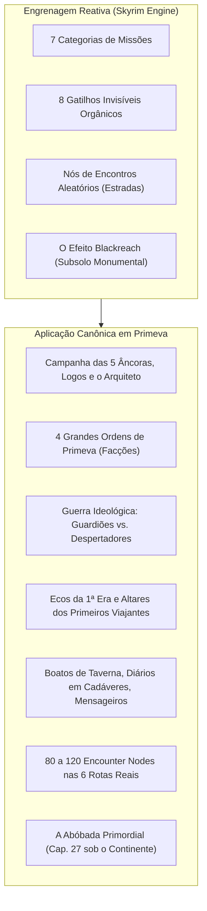
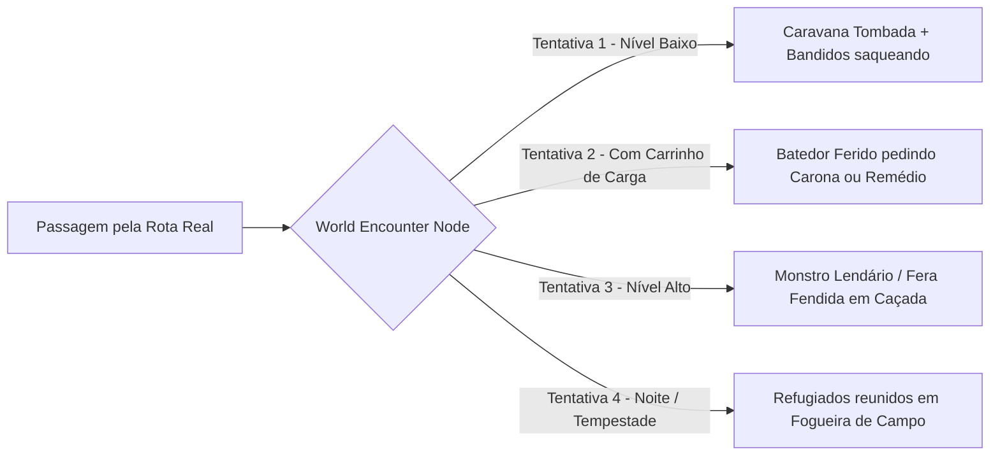

# COMO TEM QUE SER O MUNDO — PRIMEVA × SKYRIM
### Diretriz Mestre de World Design, Escala Visual e Ecossistema Reativo
**Autor:** Ian Feloniuk (Direção Geral) & Estúdio Visual Multi-Agente (Codex / Antigravity / Claude)  
**Data:** 21 de Outubro de 2026  
**Status:** BÍBLIA MESTRE DE DESIGN DE MUNDO (Vigente e Obrigatória)  
**Fontes Canônicas Cruzadas:**
- Análise Técnica: [Depois de 15 ANOS eu FINALMENTE entendi SKYRIM](https://youtu.be/pW9EmEBOMPU) (Taozen)
- Prompt Mestre Original: [PROMPT-MESTRE-ORIGINAL.md](https://drive.google.com/file/d/11FylquGg5DAMj1xg18R-v6EJxM4r6jTq/view?usp=drivesdk) na pasta [Estudio-Visual-Primeva-Skyrim](https://drive.google.com/drive/folders/1P9WxlDu-LHjzzI0pemWivd4sgwcRza2O)
- Lore e Narrativa Canônica: [Primeva - O Manuscrito Completo.pdf](https://drive.google.com/file/d/11N3vPUPkydjp0kiPh7ECRkeRIFU1Bbz-/view?usp=drivesdk)
- Ideias Futuras e Sobrevivência: [PRIMEVA — Ideias Futuras (Sobrevivência, Lenha e Carrinho)](https://docs.google.com/document/d/11_L2D8xSP7-xvrI1OdUhuOYv5NQ1qZVpPC-TkptE-zU/edit?usp=drivesdk) — Seções 10 e 11
- Base de Código Unificada: v500 a v509 (`tools/mapa500.js`, `tools/mapa501.js`, `tools/encontros502.js`, `tools/capitais504.js`, `tools/terrain245.js`)

---

## 1. O DIAGNÓSTICO DOS 15 ANOS: POR QUE SKYRIM (37 km²) PARECE COLOSSAL E PRIMEVA PARECIA PLANO

O segredo revelado após 15 anos de análise técnica não está no tamanho do mapa, mas na **Teia Reativa** e na **Quebra do Loop Repetitivo**.

### 1.1. A Quebra do Loop com Micro-Histórias
Todo RPG tradicional cai no vício do ciclo monótono:
$$\text{Sair do Abrigo} \longrightarrow \text{Matar Inimigos} \longrightarrow \text{Coletar Loot} \longrightarrow \text{Voltar}$$

Skyrim destrói esse ciclo porque a exploração colide invariavelmente com narrativas inesperadas que mudam de escala:
1. Você sai para coletar lenha e acha um caçador de tesouros morto com uma carta revelando um arco élfico mágico escondido atrás de uma cachoeira congelada.
2. Você aceita uma aposta de bebida com Sam Guevenne em uma taverna qualquer e acorda do outro lado da província, dentro de um templo com um casamento marcado e uma cabra roubada (Quest de Sanguine).
3. Você fala com um mendigo pedindo moedas em Solitude e termina transportado para dentro da mente perturbada do imperador Pelagius, jogando xadrez mental com Sheogorath.

### 1.2. Ecossistema Reativo e Autônomo
O mundo não fica congelado aguardando o jogador dar um "clique":
- NPCs têm rotinas circadianas reais (dormem em casas trancadas à noite, acordam ao amanhecer, trabalham na forja/mercado de dia e confraternizam na taverna à noite).
- O mundo dispara eventos de forma orgânica: você entra em Windhelm à meia-noite e tropeça num assassinato com sangue recente na neve (*Blood on the Ice*), com guardas interrogando testemunhas independentemente da sua missão atual.

---

## 2. POR QUE OS 100 km² DE PRIMEVA PARECIAM MENORES QUE OS 37 km² DE SKYRIM

Primeva possui 10 km × 10 km (100 km² de continente delimitado entre as coordenadas -5000 e +5000), quase o triplo da área total de Skyrim (37 km²). No entanto, o mapa sofria de quatro problemas óticos e de design:

### 2.1. Linhas de Visão Abertas Demais (Falta de Oclusão e Sightlines)
- **Problema:** Quando o relevo (`terrain245.js`) é composto por colinas suaves e desimpedidas, o olho do jogador enxerga 3 ou 4 quilômetros de chão contínuo de uma só vez. Isso cria o **"Efeito Maquete"**: o cérebro humano decodifica o terreno como uma mesa plana em miniatura, achatando completamente a percepção de distância.
- **A Solução de Skyrim:** O jogador quase nunca caminha mais de 120–150 metros em linha reta desimpedida. Paredes de rocha lascada, cristas em garganta, curvas de desfiladeiro e bosques densos de coníferas bloqueiam a visão horizontal. Para ver o que há adiante, o jogador é forçado a contornar curvas e subir elevações. Isso faz um trajeto real de 400 metros parecer psicologicamente uma jornada épica de 4 quilômetros.
- **Enquadramento de Vistas (*Vista Shots*):** Os grandes marcos (as 3 Muralhas de Aster, a Torre da Vigília Antiga, os picos glaciais de Ymiria, o Farol Ancestral de Thalor) nunca ficam 100% expostos o tempo todo. Eles surgem em "revelações emolduradas" apenas quando o jogador contorna uma curva de penhasco ou atinge o cume de uma colina.

### 2.2. Proporção Vertical entre Câmera, Personagem e Cenário
- **Problema:** Se a câmera orbitar num ângulo alto de cima para baixo olhando para árvores ou rochas de 4 a 6 metros de altura, o Viajante (2,05 m de altura canônica) parece um gigante caminhando por arbustos de jardim.
- **A Solução:** A câmera deve manter uma inclinação mais baixa e respeitosa, forçando o jogador a olhar ligeiramente de baixo para cima. Pinheiros e carvalhos nórdicos devem ter entre 15 e 25 metros de altura; penhascos e falésias devem se erguer a 20–40 metros com degraus verticais, apequenando o Viajante diante da majestade e do perigo da natureza.

### 2.3. A Lei Anti-Primitivas e Atmosfera Volumétrica
- **Problema:** Formas puras visíveis (esferas perfeitas, cilindros lisos, cones de árvore ou cubos) denunciam de imediato uma simulação matemática sintética, quebrando a imersão na hora.
- **A Solução dos 5 Especialistas:** Toda malha procedural deve passar por deformação orgânica assimétrica (*Voronoi Crackle* + *Fractal Brownian Motion*), materiais PBR táteis com relevo, acúmulo de musgo e neve orientado pela normal mundial (`normal.y > 0.6`), e neblina volumétrica de vale (*Height Fog* e *Distance Fog*) que cria a **Perspectiva Aérea** — onde montanhas a 800m adquirem tons azulados/acinzentados com névoa densa na base.

### 2.4. Densidade de Acontecimentos nas Rotas
- **Problema:** Trajetos vazios sem micro-histórias transformam caminhadas longas em mero tédio físico.
- **A Solução:** Implementação dos **Nós de Encontros Aleatórios (*World Encounter Nodes*)** a cada 100–150 metros ao longo das 6 Rotas Reais, garantindo que o jogador tropece em algo narrativo ou interativo a cada 30 a 45 segundos de caminhada ou transporte com o Carrinho de Carga.

---

## 3. A MATRIZ SKYRIM ADAPTADA À LORE CANÔNICA DE PRIMEVA (SEM MUDAR UMA VÍRGULA DO MANUSCRITO)

Toda a riqueza necessária já existe em *Primeva - O Manuscrito Completo.pdf*. A conexão técnica se dá na engrenagem a seguir:

### 3.1. As 7 Camadas de Missão Canônicas de Primeva

#### 1. Campanha Principal (Dragonborn → A Saga do Segundo Despertar)
- **História:** A defesa das 5 Pedras-Âncora nas Capitais (Ymiria, Zahar, Thalor, Urdan, Verden), a recuperação dos 3 Relatos Ancestrais da Primeira Era, a revelação da traição de Dorian/Logos e o confronto com a Mão do Arquiteto.
- **Diretriz de Design:** Fica sempre registrada no Diário de Lyra, mas **nunca impõe prazos ocultos punitivos**. O jogador pode parar a campanha a qualquer momento para viver como caçador errante, alquimista, lenhador ou mercador de carroça, retornando quando bem entender sem que o mundo "trave".

#### 2. Facções e Ordens de Primeva (Equivalente às Guildas de Skyrim)
Progresso e patentes independentes com rituais, recompensas e vestimentas próprias:
1. **A Vanguarda da Muralha (Guerreiros e Caçadores):** Liderada pelos veteranos Brann e Edran. Foco em patrulhas das fronteiras, resgate de caravanas, defesa contra cercos de Fendas e caçadas às Feras Lendárias dos biomas (Dragões das 5 espécies, Lobo Fendido, Ursos Ancestrais).
2. **Círculo Cartográfico e Alquímico (Eruditos e Magos):** Conduzido pelo pesquisador Aldric e a alquimista Mira. Foco em resgatar tabuletas da Primeira Era, mapear anomalias de éter, estudar a flor-da-abóbada e criar fórmulas de poções e elixires arremessáveis raros.
3. **Artífices de Aço e Ferrugem (Ferreiros e Construtores):** Sob a tutela de Kael e dos mestres do Clã Ferrugem de Urdan e estaleiros de Thalor. Foco em encontrar veias de Mithril, restaurar a Grande Forja de Aster, fabricar peças para o Carrinho de Carga, veleiros pesados e as armas customizadas de matéria de monstro.
4. **Rede de Caravanas e Sombras (Assassinos e Investigadores):** Operando nos bastidores do Banco de Selene e tavernas das Capitais. Foco em desbaratar contrabandistas, recuperar cargas perdidas, vigiar as células infiltradas de Logos e executar contratos de silêncio contra traidores.

#### 3. Conflito Ideológico / Guerra Civil (Imperiais vs. Stormcloaks)
- **Tensão Política:** Não há uma disputa simplória de "bem contra o mal", mas um dilema ético profundo entre duas visões sobre o destino de Primeva:
  - **Os Guardiões das Âncoras (Leais à Ordem de Aster):** Defendem que as 5 Pedras-Âncora devem permanecer eternamente seladas e alimentadas, mesmo que isso custe sangue e sacrifício constante, pois sua quebra trará o caos primordial.
  - **Os Despertadores do Ciclo (Dissidentes seduzidos pela filosofia de Logos):** Acreditam na tese de Dorian de que as Âncoras são uma jaula cósmica que impede a evolução natural de Primeva, prolongando uma agonia artificial. Eles buscam desestabilizar os selos para forçar o Novo Ciclo.
- **Impacto no Jogo:** Cada uma das 5 Capitais possui focos de revolta ou lealdade, alterando preços no mercado, presença de guardas na muralha e reações aos contratos de caça.

#### 4. Missões de Ecos Ancestrais & Artefatos Únicos (Equivalente às Daédricas)
- **História:** Relíquias esquecidas deixadas pelos Primeiros Viajantes (do ciclo original do Narrador) e fissuras onde a Mão do Arquiteto toca o mundo físico.
- **Mecânica:** Santuários escondidos no meio dos biomas que exigem testes morais ou sacrifícios de recursos em troca de armas de lenda, relíquias de poder passivo único e as **Coroas dos 10 Conjuntos Raros** (Metamorfo, Tecelão, Lâmina Espiritual, Necromante, etc., conforme o *Guia de Geração Visual*).

#### 5. Missões Secundárias com Identidade Própria
- Aventuras completas iniciadas por cidadãos comuns (um pescador de Thalor que perdeu a tripulação para um monstro marinho e pede vingança; uma família de mineradores em Urdan presa numa galeria de cristais venenosos; a busca por uma criança perdida nas florestas sussurrantes de Verden).

#### 6. Missões Diversas (*Miscellaneous Quests*)
- Objetivos curtos no diário que servem de "isca" para mergulhos mais profundos: "Encontre o paradeiro do batedor desaparecido no deserto de Zahar", "Investigue o rumor sobre luzes no fundo do lago de Aster".

#### 7. Missões Procedurais / Contratos do Quadro (*Radiant Quests*)
- Contratos dinâmicos no quadro de avisos das cidades: abater bandos de saqueadores, fornecer 20 toras de madeira para reforço do portão, caçar lobos que ameaçam as ovelhas ou purificar um portal instável num raio de 500m.

---

### 3.2. Os 8 Gatilhos Invisíveis Orgânicos

O jogador nunca é obrigado a ir a uma placa de exclamação amarela fixa. As missões começam organicamente por:
1. **Conversa Voluntária e Boatos de Taverna:** Falar com taverneiros, mercadores ou bêbados traz fofocas locais que abrem entradas no diário.
2. **Abordagem Forçada de NPC:** Um mensageiro assustado corre até você na estrada gritando por socorro, ou um guarda ferido rasteja pedindo um gole de água ou poção.
3. **Diálogos Ouvidos ao Passar (*Eavesdropping*):** Ao caminhar pelo mercado de Aster ou pelo cais de Thalor, dois NPCs conversam sobre uma carga roubada; ouvir a conversa atualiza seu mapa com um ponto de interrogação.
4. **Mensageiros nas Rotas Reais:** Enquanto viaja com o Carrinho ou a pé, um batedor expresso a cavalo para ao seu lado e entrega uma carta selada de Lyra ou Aldric.
5. **Leitura de Cartas, Livros e Diários em Cadáveres:** Vasculhar uma carcaça abandonada no meio da neve revela um diário cujas últimas páginas contam sobre um tesouro enterrado.
6. **Gatilhos por Nível de Desafio / Rank:** Ao alcançar Rank C ou nível 25, novos perigos e emissários aparecem nas capitais, cientes da sua fama crescente.
7. **Eventos Presenciados no Local:** Você chega ao portão de uma vila e vê uma caravana de mercadores sendo atacada por criaturas de fenda; intervir salva os NPCs e gera recompensas imediatas de gratidão e desconto comercial.
8. **Nós de Encontros Aleatórios (*World Encounter Nodes*):** Pontos invisíveis distribuídos pelas rotas que sorteiam encontros dinâmicos.

---

## 4. NÓS DE ENCONTROS ALEATÓRIOS NAS 6 ROTAS REAIS (WORLD ENCOUNTER NODES)

As 6 grandes vias que conectam Aster (0,0) às 5 Capitais (Ymiria ao Norte, Zahar a Leste, Thalor a Oeste, Urdan ao Sul e Verden ao Sudeste) contam com **80 a 120 pontos invisíveis no código** (`tools/encontros502.js`).

### Comportamento Técnico:
- **Não há repetição cansativa:** A semente determinística calcula a passagem do tempo e o nível do jogador. Passar pela mesma garganta três vezes gera três situações completamente diferentes.
- **Interação com a Sobrevivência e o Carrinho de Carga:**
  - Se o jogador estiver puxando o Carrinho de Carga cheio de toras ou minérios, eventos específicos de escolta ou pedido de madeira para consertar pontes podem ser acionados.
  - Carcaças de animais e restos de viajantes oferecem suprimentos imediatos (cordas, pedras, ervas, couro).

---

## 5. O EFEITO BLACKREACH NO PRIMEVA: A ABÓBADA PRIMORDIAL (CAPÍTULO 27)

Skyrim faz o jogador se apaixonar pelo mundo quando ele entra numa ruína qualquer de anões em Riften para fazer uma tarefa comum e "despenca" em **Blackreach** — uma cidade subterrânea titânica com cogumelos bioluminescentes gigantes que se estende por baixo de metade do mapa da província.

### A Aplicação Canônica no Primeva:
- O Manuscrito Completo descreve no **Capítulo 27** a existência da **Abóbada Primordial**: a fundação geológica e mística do mundo antigo anterior às Pedras-Âncora.
- **Como Funciona no Jogo:**
  1. Cavernas comuns de mineração em Urdan, poços profundos em ruínas de templos antigos ou Fendas Submersas abissais na costa de Thalor contêm passagens secretas rachadas na rocha.
  2. Ao rastejar por essas fendas, o jogador não carrega uma tela de loading genérica: a câmera se abre em um **subsolo colossal** repleto de catedrais de coral branco petrificado, pontes de pedra suspensas sobre abismos de éter, cogumelos fosforescentes e estradas ancestrais que conectam as regiões por debaixo da terra.
  3. Fazer essa transição transforma a lore do livro de mero texto abstrato em um espaço físico monumental explorável.

---

## 6. QUADRO TÉCNICO DOS 5 AGENTES ESPECIALISTAS (ESTÚDIO VISUAL PRIMEVA × SKYRIM)

Seguindo a regra obrigatória de governança do Estúdio Visual, as decisões técnicas para a execução deste mundo são consolidadas a seguir:

| Especialista | Técnica & Matemática Escolhida | Deformação / Material / Shaders | Critério Observável no Jogo |
| :--- | :--- | :--- | :--- |
| **1. Diretor de Arte** *(Skyrim × Primeva)* | Paleta nórdica dessaturada com terra, carvão e líquen; contraste místico reservado a Gemas, Fendas e Pedras-Âncora. | Luz solar rasante (baixo ângulo), neblina volumétrica de vale (*Height Fog* a 8–25m do solo) e umidade nas rochas. | Silhuetas assimétricas pesadas; eliminação de qualquer aspecto cartoon, plástico ou blocudo na câmera do jogador. |
| **2. Engenheiro de Geometria** *(Anti-Blocos)* | Tesselagem adaptativa com *Voronoi Crackle* + *Fractal Brownian Motion (FBM)* e estratificação geológica em Y. | Rochas e falésias com quinas lascadas e degraus; árvores de 15–25m com tronco helicoidal, raízes expostas e copas em camadas. | Proibição absoluta de cilindros retos, esferas lisas ou cones puros; quebra total das linhas de visão a cada 150m. |
| **3. Especialista em Shaders** *(PBR & Gemas)* | Shaders PBR com blend por inclinação/normal mundial: `dot(normal, vec3(0,1,0)) > 0.6` para musgo e neve. | Água com refração por profundidade e espuma dinâmica em bordas de colisão; cristais angulares com Fresnel e núcleo pulsante. | Superfícies táteis com rugosidade realista; materiais não brilham como plástico sob o sol ou luz das tochas. |
| **4. Ecólogo de Biomas** *(Scattering Natural)* | Distribuição ecológica por *Poisson Disk* e *Clusters* determinísticos via semente única (`mulberry32`). | Árvore-mãe circundada por árvores jovens, arbustos, rochas caídas e tocos; vento sutil no *Vertex Shader* defasado por posição. | Transições de bioma suaves; sem árvores em declives verticais; margens de rios povoadas de juncos e pedregulhos úmidos. |
| **5. Arquiteto de Performance** *(Integração WebGL)* | Agrupamento em `InstancedMesh`, matrizes pré-computadas fora do render loop e matriz LOD por anéis de distância. | Culling agressivo de objetos ocultos por trás de falésias; renderização paginada e reutilização estrita de materiais. | Manutenção de taxa estável de quadros no motor WebGL sem engasgos de lixeira (*garbage collector*) durante a viagem de carroça. |

---

## 7. INTEGRAÇÃO COM A BASE DE CÓDIGO (v500 A v509) E PRÓXIMOS PASSOS

A outra conversa e os commits mais recentes já assentaram os alicerces fundamentais deste mundo:
- **v500:** Fixou o continente finito de 10 km × 10 km com mar a oeste/leste/sul, cordilheira intransponível ao norte e as 5 Capitais fixas em seus biomas.
- **v501:** Implementou o mapa-múndi no minimapa e na tela grande com leitura de rotas e capitais.
- **v502 & v506:** Estabeleceu a densidade de encontros a cada ~150 m com modelos Tripo integrados (acampamentos, covis, altares, ruínas com prédios caídos, NPCs errantes).
- **v504, v507 & v508:** Ergueu muralhas de 150m de raio, portões com tochas, marcos luminosos nas capitais e terreno distante renderizado até o horizonte.
- **v503 & v509:** Finalizou a sincronização das 30 habilidades marciais ativas (Guerreiro, Assassino, Tanque) com impacto e animações fieis.

### Roteiro de Aplicação Prática Imediata:
1. **Oclusão de Terreno (`tools/terrain245.js`):** Ajustar as curvas de desnível nas 6 Rotas Reais para erguer cristas e gargantas rochosas a cada 120–150 metros, garantindo que Aster e as Capitais só sejam vistas ao atingir o ponto de descortino cenográfico.
2. **Escala Vertical 3x:** Multiplicar a escala visual dos pinheiros nórdicos e falésias marginais de 6–8m para 18–24m, alinhando a proporção da câmera de terceira pessoa.
3. **Mapeamento dos 80–120 Encounter Nodes:** Expandir `tools/encontros502.js` para registrar formalmente os nós invisíveis nas rotas com eventos de micro-histórias baseados no nível do jogador e no Manuscrito Canônico.
4. **Entrada da Abóbada Primordial:** Conectar a primeira fenda subterrânea em Urdan/Thalor à galeria monumental de coral branco do Capítulo 27.

---
*Este documento é a diretriz oficial unificada entre todas as frentes de inteligência artificial do projeto Primeva. Qualquer nova funcionalidade, bioma ou missão deve ser calibrada rigorosamente conforme os pilares aqui estabelecidos.*
